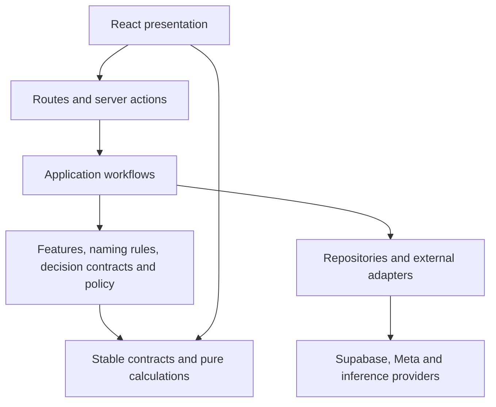

# DeepVisor architecture

DeepVisor is a Next.js App Router application with Supabase persistence/authentication,
Meta ingestion, account intelligence and separately authorized advertising actions.
This document describes the checked-in implementation. It does not assert that a
provider, worker schedule or execution gate is deployed or enabled.

## Responsibilities and dependency direction

These are logical responsibilities, not five new top-level directories. Existing
feature cohesion is retained:

| Responsibility | Implementation and boundary |
| --- | --- |
| Presentation | `src/app` pages/layouts and `src/components`; browser state/hooks in `lib/client`. Server Components may compose authorized loaders; Client Components receive DTOs or call routes/server actions. |
| Application | `app/api`, route-local actions, `lib/server/actions`, and domain `service.ts`/`load.ts` modules. Resolve authentication, validate scope, sequence work and shape responses. |
| Domain | `server/features`, `decisions/policy`, decision validation/contracts, `shared/organizer`, `shared/performance`, `shared/reports`. Calculations do not own credentials or fetch data. |
| Infrastructure | Supabase clients/repositories, `integrations/adapters`, `sync/meta`, Jev provider and `advertising` adapters. Persistence implements business-scoped operations and durable claims. |
| Shared | Browser-safe contracts, domain calculations and genuinely reusable formatting. Generated DB bindings are transport types, not the product domain model. |

Dependencies should point toward contracts/calculations. A server repository must
not import UI; shared domain logic must not import server workflows. Use explicit
type-only imports for cross-layer DTOs and preserve compatibility exports during
moves. `server/data` and `server/repositories` currently coexist; see the
[map](CODEBASE_MAP.md) rather than inferring ownership from their names.

## Identity, authorization and configuration

[`src/proxy.ts`](../src/proxy.ts) refreshes/validates sessions on matched page paths.
It excludes API routes: each handler must authorize independently.
[`getRequiredAppContext`](../src/lib/server/actions/app/context.ts) resolves the
authenticated user, organization membership, business, role and onboarding state.
[`business/context.ts`](../src/lib/server/actions/business/context.ts) uses the
`ensure_onboarding_workspace` RPC when needed; successful business context is cached
per user for 30 seconds. [`resolveCurrentSelection`](../src/lib/server/actions/app/selection.ts)
validates selected integration/account cookies against business-owned records.

The cookie-bound [`server.ts`](../src/lib/server/supabase/server.ts) client and
[`browser.ts`](../src/lib/client/supabase/browser.ts) client use session/RLS access.
[`admin.ts`](../src/lib/server/supabase/admin.ts) is server-only and bypasses RLS;
its callers must establish business/account authorization and filter reads/writes.
Never treat browser-supplied IDs as authorization. Owner/admin review and execution
checks are stronger than member read access and must remain at mutation boundaries.

Environment configuration stays at server adapters/entry points. Meta tokens are
resolved through the existing integration/Vault path. Jev, OpenAI, service-role and
internal worker credentials must never be `NEXT_PUBLIC_*`, included in DTOs, or logged.
There is no single global configuration object; keep new configuration owned by its
integration and validate before side effects.

## Data model and lineage

The [generated bindings](../src/lib/shared/types/supabase.ts) cover `public`, `ai`
and `intelligence`. The [migration directory](../supabase/migrations) records
incremental changes and security constraints, but does not contain a complete
bootstrap schema.

| Model | Role |
| --- | --- |
| `organizations`, `organization_memberships`, `business_profiles` | Tenant identity, role and business/onboarding preferences. |
| `platforms`, `platform_integrations`, `ad_accounts`, `oauth_states` | Provider catalog, business connection, internal/external account identity, one-time OAuth state. |
| `ad_account_sync_state`, `account_sync_jobs` | Coverage, durable queued/running/completed work and recovery state. |
| `ad_entities`, `ad_creatives` | Unified campaign → ad set → ad hierarchy and recognizable media. External Meta IDs differ from internal UUIDs. |
| `ad_entity_performance_*`, `ad_account_performance_*` | Normalized daily/hourly/monthly/summary observations; preserve account timezone, currency, entity level and missingness. |
| `campaign_dims`, `adset_dims`, `ad_dims` and legacy performance tables | Compatibility reads/writes still used by reports, campaign tables and intelligence. Not replaceable merely because unified entities exist. |
| `ai.business_assessments`, intelligence findings/signals/calendar/report records | Existing account digests, findings, workflow queues, notifications and archives. |
| `ai.feature_snapshots` → `decision_runs` → `action_proposals` → `executed_actions` → `action_outcomes` | Versioned evidence, provider result, proposed intent, execution audit and observational measurements. |
| `ai.autonomy_policies`, evaluation jobs, execution claims/controls | Independent policy configuration, inference deduplication and durable execution exclusion. |
| `account_organization_baselines`, `account_organization_versions`, `organization_rename_*` | Immutable original/source snapshots, proposal versions, fingerprinted approvals, runs/events and isolated simulation state. |

Decision records use composite business/parent relationships; RLS allows scoped
reads while privileged writes/RPCs are reserved for trusted services. Organizer
history has immutable records and restoration lineage. Do not infer delete behavior
across all tables: rename audit constraints intentionally restrict cascading deletion.

Missing data is not zero or healthy. An active delivery chain differs from historical
spend. Aggregate ratios from totals; don't claim summed daily reach is unique
multi-day reach. Feature V1 explicitly retains its `summed_daily_reach` frequency
basis. Outcomes are observations, not proven causal impact.

## Systems and external services

- **Meta ingestion:** OAuth/account discovery in `integrations`; queue orchestration
  and reads in `sync`; persistence in repositories. Read/sync work never authorizes
  an advertising write. Edge functions forward authenticated requests to the app.
- **Account intelligence:** `intelligence` builds assessments, trends, signals,
  calendar work and report context. Some assessment paths use the separate OpenAI
  structured adapter; this is not the Jev DecisionProvider.
- **Feature/decision/policy:** `buildFeatureSnapshot` computes versioned facts;
  `DecisionEngine` persists and validates provider-neutral results; `PolicyEngine`
  deterministically returns HOLD/BLOCK/SHADOW_ONLY/REQUIRE_APPROVAL/ALLOW_EXECUTION
  according to mode and evidence. The engine itself neither proposes nor executes.
- **Jev:** `JevDecisionProvider` implements the pinned System One choice contract,
  with identity validation, redacted audit and bounded read/inference retries.
  Provider failure is a failed run, never a fabricated HOLD or LLM fallback.
- **Advertising:** Review and separately gated Limited Auto reuse the execution
  layer. Durable claim → policy/state revalidation → checkpoint → one write → readback.
  An uncertain write retains its claim; no automatic replay/rollback.
- **Organizer:** deterministic inspection/naming and version storage are separate
  from name-only Meta execution and restoration. Each restoration is a new proposal.
- **Other integrations:** existing Stripe actions, media/storage, map and presentation
  libraries remain compatibility dependencies; their presence does not establish a
  second advertising platform adapter or an enabled billing workflow.

## Safety and operational references

Read these before changing the corresponding workflow; they own detailed gate and
reconciliation contracts:

- [Integration and sync](../src/lib/server/integrations/README.md)
- [Feature semantics](../src/lib/server/features/README.md)
- [Decisions/Jev](../src/lib/server/decisions/README.md) and [PolicyEngine](../src/lib/server/decisions/policy/README.md)
- [Shadow](../src/lib/server/decisions/shadow/README.md), [Review execution](../src/lib/server/advertising/README.md), [Limited Auto](../src/lib/server/advertising/LIMITED_AUTO.md)
- [Outcomes](../src/lib/server/decisions/outcomes/README.md)
- [Organizer inspection](../src/lib/server/organizer/README.md) and [rename/restoration](../src/lib/server/organizer/PHASE2.md)

For source-level entry points and sequence diagrams, use [Flows](FLOWS.md).
For known exceptions and deferred work, use the [audit](ARCHITECTURE_AUDIT.md).
