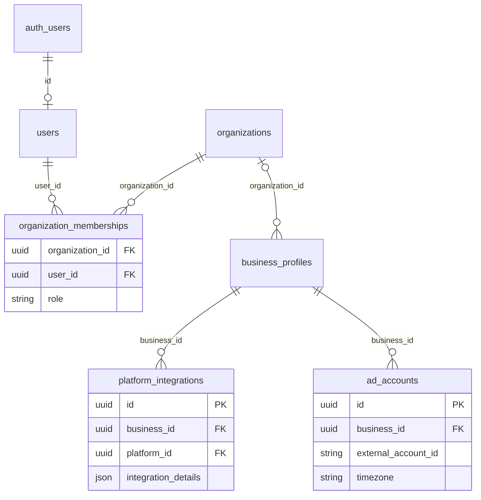
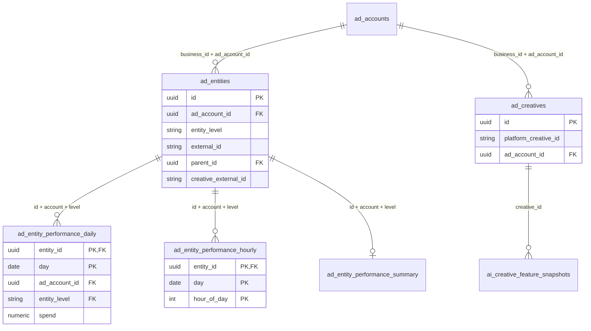
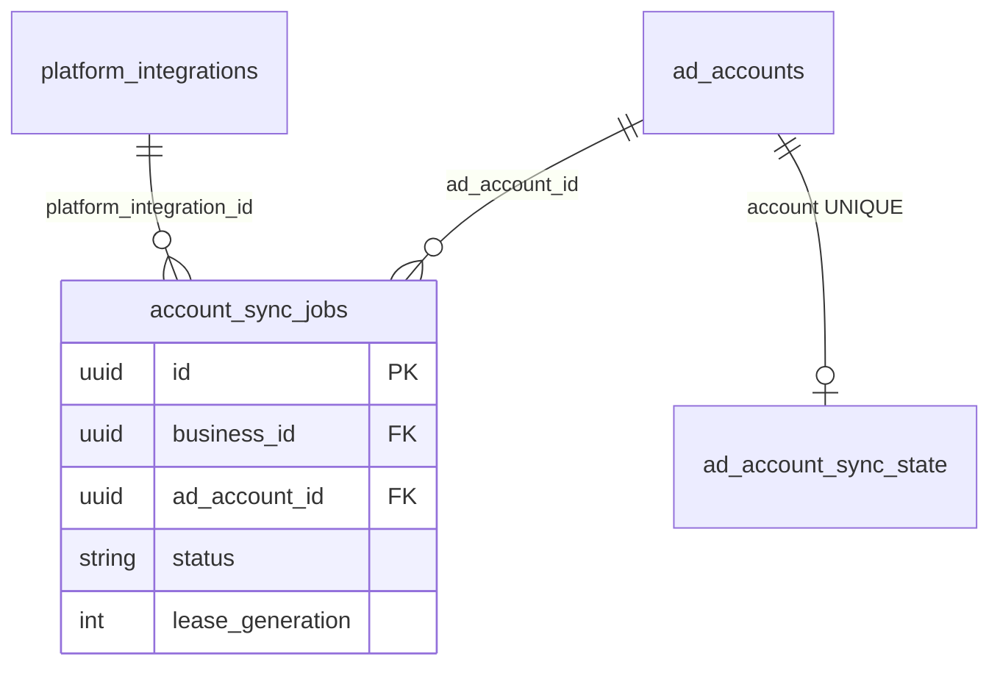
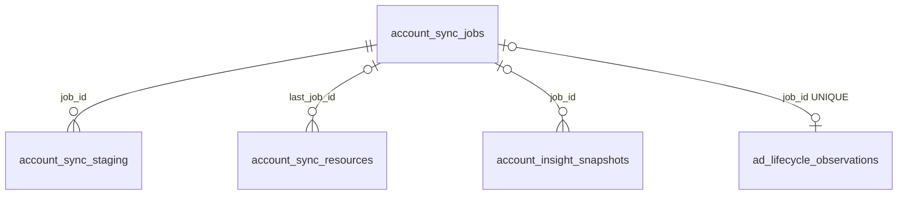
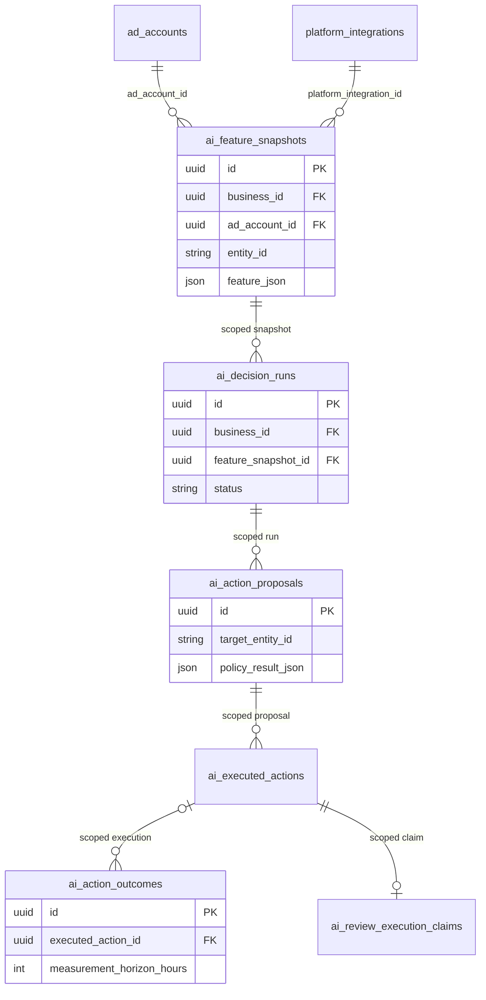
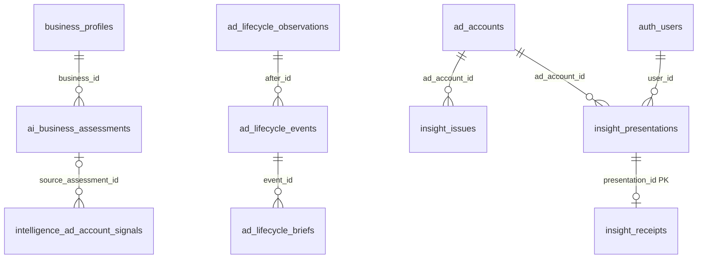

# Database relationships

Purpose: navigate ownership and lineage without treating every matching ID as a foreign key.
Verified against committed migrations/bindings and development catalog metadata on
2026-11-13; see the [verification ledger](SYSTEM_DIAGRAM.md#verification-ledger--2026-11-13).
`public` is the default schema below; `ai_` / `intelligence_` prefixes denote schemas.
Fields are selected keys, not complete table definitions.

**Legend:** ERD edges below are physical foreign keys only. Crow's feet show possible
row counts, including zero children. Optional parent ends reflect nullable columns.
Labels name FK columns (account/integration/level are shortened in composite labels); composite keys are stated explicitly. Logical matches and
derivations appear in tables outside the ERDs. An FK alone does not enforce tenant,
entity-level or current-delivery semantics.

## Tenant and connection ownership

Supabase Auth owns identity; `public.users` is an optional app profile, and membership
uniqueness is `(organization_id,user_id)`. Both integrations and accounts have physical platform_id FKs to the platforms catalog
(omitted from the tree for readability). A business has at most one integration per
platform (`UNIQUE business_id,platform_id`). An organization may own many businesses;
no one-business-per-organization constraint was observed; organization_id is nullable
in storage even though normal app context requires a workspace. Account-to-integration is
**logical** through shared business/platform and selected-account integration JSON,
not a direct account FK. Selection cookies are validated hints, not ownership.
[App context](../src/lib/server/actions/app/context.ts),
[integration service](../src/lib/server/integrations/service.ts),
[onboarding migration](../supabase/migrations/20261021014607_atomic_onboarding_workspace.sql).

## Meta hierarchy and observations

Meta owns campaign → ad set → ad identity and delivery. The app stores all three in
`ad_entities`, unique by `(ad_account_id,entity_level,external_id)`. Internal UUIDs
must not be confused with Meta IDs. The omitted optional self FKs parent_id, campaign_id and adset_id use `ON DELETE SET NULL`; they do not by
themselves enforce same-account parentage or campaign/ad-set level. Fact composite
FKs enforce `(entity_id,ad_account_id,entity_level)`; daily PK is `(entity_id,day)`.
Monthly facts use `(entity_id,month_start)`; account monthly facts reference accounts.
Summary is at most one row per entity; its apparent reporting window needs its own
coverage fields, not a presumed daily grain.

| Relationship | Enforcement / source |
| --- | --- |
| External hierarchy references | `parent_external_id` and level-specific external IDs are logical Meta references, used by explorer traversal; they coexist with UUID self FKs and must stay consistent. [Explorer loader](../src/lib/server/campaigns/exploration/load.ts). |
| Ad → creative | Logical `creative_external_id` → `platform_creative_id`, scoped by business/account; no creative FK on entity. Multiple ads may reuse a creative; missing creative is permitted. [Explorer loader](../src/lib/server/campaigns/exploration/load.ts). |
| `campaign_dims`, `adset_dims`, `ad_dims`, legacy daily/summary/hourly names | Compatibility views, not duplicate tables in inspected development schema. [Schema migration](../supabase/migrations/20260510000100_account_intelligence_schema.sql); [campaign writer](../src/lib/server/repositories/campaigns/upsertCampaignDims.ts) delegates to unified entity writes. |
| Metrics → UI | Derived ratios/read models; ad-set cards use ad-set observations even when the media comes from an ad. [Overview](../src/lib/server/dashboard/overview/load.ts), [feature contract](../src/lib/server/features/README.md). |

## Sync lifecycle and resource publication

Publication grain: staging PK `(job_id,generation,chunk)`; resource PK
`(ad_account_id,resource_key)`; optional-insight PK `(ad_account_id,dataset)`.

PostgreSQL owns durable job state, coverage, revision and resource demand. The partial
unique index `account_sync_jobs_one_active_account` permits one queued/running job
per account across triggers. Separate business/account/integration FKs on jobs do
not establish their joint scope. Resources also have a physical ad_account_id FK (omitted from this view).
State success/failure pointers also reference jobs;
resource and optional-insight job pointers become null when jobs are deleted.
[Queue repository](../src/lib/server/repositories/ad_accounts/syncState.ts),
[resource contract](../src/lib/server/sync/resources/README.md). Staged publication
is atomic for resource jobs; legacy full sync is not one atomic account snapshot.

## Decisions and authorized actions

The many execution rows per proposal represent permitted audit history, not permission
to replay a write. The omitted claim-to-proposal FK also includes business_id. Claims have unique proposal and execution IDs and one active claim
per business. Outcomes refer to either an executed action or a Shadow run via the omitted business_id/shadow_decision_run_id FK (exclusive CHECK),
unique by business/source/horizon. All scoped chain edges
include `business_id` and the named parent ID; snapshot account/integration scope is also checked by
`validate_v2_snapshot_scope` trigger. Snapshot `entity_id` and proposal target IDs
are text provider references, **not FKs to `ad_entities.id`**. Questions, metrics and
policy evidence are saved JSON, not live joins. [V2 migration](../supabase/migrations/20261006000000_add_v2_decision_persistence.sql),
[claims](../supabase/migrations/20261007000000_add_review_execution_claims.sql),
[decision contract](../src/lib/server/decisions/README.md),
[outcome semantics](../src/lib/server/decisions/outcomes/README.md).

## Intelligence, events and delivery

Assessment account scope is stored in the assessment contract/JSON; signals add
explicit account ownership and an optional assessment FK. Lifecycle events also have an optional before_id FK to observations (omitted to avoid
overlapping parallel edges). The signal ad_account_id FK is omitted from this view.
A presentation's issue,
lifecycle and daily evidence is an immutable **derived payload**, not a direct FK to
each source row. Review/seen-source cursors are per user/account, distinct from issue
resolution; notifications are a separate business/user-owned delivery store.
[Assessments](../src/lib/server/intelligence/repositories/assessments.ts),
[signals](../src/lib/server/intelligence/signals/service.ts),
[Insights & Events](../src/lib/server/insights/README.md),
[event migration](../supabase/migrations/20261109161829_insights_events.sql).
Missing lifecycle capture does not imply no transition or a healthy account.

Organizer is a separate immutable lineage: account → baseline (unique business/account)
→ version (unique baseline/version) → preview → approval → run → events. Composite
scope FKs protect previews/versions and audit links; restore links point back to runs.
It shares execution exclusion with review, not decision-provider authority.
[Organizer contract](../src/lib/server/organizer/PHASE2.md) owns the full safety model.
