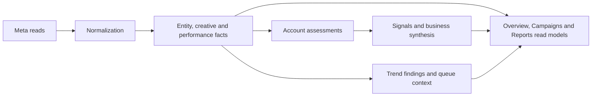
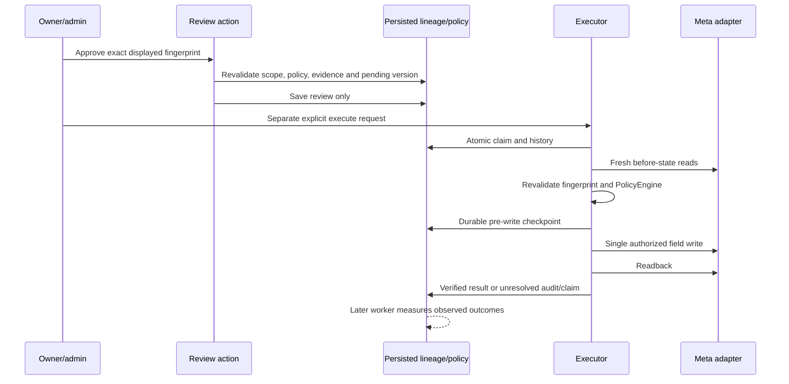
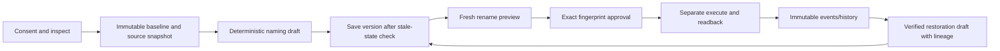

# Core workflows

These sequences describe the checked-in call paths. They do not imply that hosted
schedules, inference providers or live execution are enabled. Authentication and
selected-account validation occur before privileged account reads; worker entry
points use their independent internal credentials and persisted job scope.

## 1. Meta connection and synchronization

```mermaid
sequenceDiagram
  participant U as Browser
  participant R as Integration routes
  participant M as Meta
  participant DB as Supabase
  participant W as Existing sync worker
  U->>R: Connect Meta
  R->>DB: Store one-time OAuth state
  R-->>U: Redirect to Meta
  M-->>R: Callback code and state
  R->>DB: Consume state; persist integration/token reference
  R->>M: Exchange/validate token; discover accounts
  R->>DB: Save accessible accounts
  R-->>U: Select account or continue single-account path
  U->>R: Select saved business-owned account
  R->>DB: Save primary selection; enqueue first history job
  R->>W: Process targeted job
  W->>M: Read dimensions, creatives and insights
  W->>DB: Persist observations and durable coverage/progress
  R-->>U: Return actual job/coverage state
```

Entry points: [`connect/[platform]`](../src/app/api/integrations/connect/[platform]/route.ts),
[`callback/[platform]`](../src/app/api/integrations/callback/[platform]/route.ts),
[`select-ad-account`](../src/app/api/integrations/meta/select-ad-account/route.ts).
[`integrations/service.ts`](../src/lib/server/integrations/service.ts) owns
`createOAuthState`, `consumeOAuthState`, `upsertPlatformIntegration`, token access,
account listing and primary selection. [`syncSelectedMetaAdAccount`](../src/lib/server/integrations/metaSelection.ts)
uses discovered server state, not an arbitrary browser account ID. The selection
route attempts the first targeted job and returns its actual status.

[`processMetaBackfillJobs`](../src/lib/server/sync/meta/processBackfillJobs.ts)
claims durable jobs. Initial history uses `processMetaFirstSyncJob`; other supported
types use `syncBusinessPlatform` → `syncMetaBusinessPlatform`. First history reads
recent data before older history. Queue/coverage operations live in
[`ad_accounts/syncState.ts`](../src/lib/server/repositories/ad_accounts/syncState.ts).

Refresh has three existing triggers sharing this infrastructure:

| Trigger | Entry and distinction |
| --- | --- |
| Manual | [`/api/sync/refresh`](../src/app/api/sync/refresh/route.ts) → `runManualBusinessSync`; selected account validation and separate manual cooldown. |
| App visit/focus | [`AutomaticMetaSync`](../src/components/integrations/AutomaticMetaSync.tsx) → [`automatic-refresh`](../src/app/api/sync/automatic-refresh/route.ts) → `enqueueAutomaticAccountSync`; durable account-local day/staleness checks. |
| Scheduled | [`scheduled-refresh`](../src/app/api/sync/scheduled-refresh/route.ts) → `enqueueScheduledAccountSyncJobs`; internal authorization, existing SQL eligibility/deduplication. |

[`dispatchAccountSync`](../src/lib/server/sync/dispatch.ts) performs targeted
post-response work and invalidates visible data. The authenticated
[`process-backfill-jobs` route](../src/app/api/integrations/meta/process-backfill-jobs/route.ts)
also schedules `drainShadowJobs` and `processActionOutcomes` with `after()`, even on
idle ticks. Edge [`processAccountSyncJobs.ts`](../supabase/functions/_shared/processAccountSyncJobs.ts)
forwards to it; `process_meta_backfill_jobs` is a compatibility function name.
Browser `router.refresh()` only reloads persisted views. Existing cron SQL is an
operator deployment procedure, not a setup command for this refactor.

## 2. Ingestion through account intelligence



[`sync/meta/fetch.ts`](../src/lib/server/sync/meta/fetch.ts) and
[`normalization.ts`](../src/lib/server/sync/meta/normalization.ts) handle provider
reads and shapes. `syncMetaCampaigns`, `syncMetaAdsets`, `syncMetaAds`,
`syncMetaAdCreatives` and `syncMetaPerformance` write legacy and unified records
through their repositories. Creative media follows Meta response → `ad_creatives`
→ [`exploration/model.ts`](../src/lib/server/campaigns/exploration/model.ts) / shared
media helpers → presentation. Ad-set card metrics remain ad-set metrics.

[`syncBusinessPlatform`](../src/lib/server/sync/syncBusinessPlatform.ts) invokes
`runMetaAdAccountAssessment`, `syncMetaAccountIntelligenceArtifacts`,
`syncMetaTrendIntelligenceArtifactsForQueueState` and `runBusinessAssessment` on its
eligible non-simulation path. Initial-history orchestration has its own completion
path in [`processFirstSyncJob.ts`](../src/lib/server/sync/meta/processFirstSyncJob.ts).
Assessment/trend code owns persisted digests/findings and existing queue artifacts;
it is distinct from versioned Feature Engine/DecisionEngine evaluations.

Account-level read composition starts at
[`intelligence/service.ts`](../src/lib/server/intelligence/service.ts). Current
Overview reads normalized persisted facts through
[`overview/load.ts`](../src/lib/server/dashboard/overview/load.ts), with decision
lineage in [`decisionRecords.ts`](../src/lib/server/dashboard/overview/decisionRecords.ts).
No provider is called by those Overview loaders. Optional missing evidence is
reported unavailable; a successful sync is not a completed decision evaluation.

## 3. Features → decisions → policy

```mermaid
flowchart LR
  S[Completed Meta sync] --> Q[Opt-in evaluation enqueue and durable claim]
  Q --> F[buildFeatureSnapshot]
  F --> E[DecisionEngine]
  E --> P[DecisionProvider]
  P --> V[Identity and result validation]
  V --> D[Persist decision run]
  D --> R[Review or Shadow evaluator]
  R --> Y[PolicyEngine]
  Y --> A[Persist policy result and eligible proposal]
```



The historical name [`enqueueShadowAfterSync`](../src/lib/server/decisions/shadow/service.ts)
coordinates both separately gated Shadow and Review modes. Enqueue RPCs snapshot
source facts/policy, source hash, cutoff and evaluation version. Claims reserve
snapshot/run/proposal IDs before inference; unchanged sources are deduplicated.
`drainShadowJobs` dispatches mode-specific workers. `runShadowJob` and
[`runReviewJob`](../src/lib/server/decisions/review/service.ts) recheck source freshness,
provider version and policy consistency, and append saved business objectives through
[`agencyQuestions`](../src/lib/server/agency/objectives.ts).

[`buildFeatureSnapshot`](../src/lib/server/features/buildFeatureSnapshot.ts) uses
explicit account-day input and 7/30-day windows plus prior comparisons. It does not
fetch, persist or infer. Shared calculations preserve V1 formulas and missing-data
handling. [`DecisionEngine.evaluate`](../src/lib/server/decisions/DecisionEngine.ts)
persists a pending run, invokes the injected provider, validates identity/JSON/result,
and persists completion or failure. Jev and the deterministic development provider
implement the same [`DecisionProvider`](../src/lib/server/decisions/types.ts).

[`evaluateShadowPolicy`](../src/lib/server/decisions/shadow/evaluate.ts) records
actual SHADOW and counterfactual REVIEW outcomes without Meta writes.
[`evaluateReviewPolicy`](../src/lib/server/decisions/review/evaluate.ts) uses read-only
current Meta state for action recommendations. [`PolicyEngine.evaluate`](../src/lib/server/decisions/policy/PolicyEngine.ts)
checks evidence, scope, freshness, budget ownership/limits, locks and action history.
It does not perform persistence or HTTP. HOLD and INSUFFICIENT_DATA are valid
decisions; malformed/provider failures cannot be converted into either.

## 4. Recommendation → approval → execution → outcome



[`reviewDecisionAction`](../src/app/(root)/decisions/actions.ts) calls
[`reviewProposal`](../src/lib/server/decisions/reviewProposal.ts), which rechecks
owner/admin role, business, snapshot target, policy and execution absence. Its
optimistic pending/updated-at update binds the review to
[`approvalFingerprint`](../src/lib/server/decisions/approval.ts). Approval does not
enqueue execution.

[`POST /api/decisions/proposals/[proposalId]/execute`](../src/app/api/decisions/proposals/[proposalId]/execute/route.ts)
validates session/origin/role and calls `executeMetaProposal` → `ReviewExecutor` →
`MetaActionAdapter`. It accepts proposal identity, not browser credentials or an
arbitrary budget payload. All environment/business policy gates, claim/idempotency,
locks, cooldowns, before-state and readback checks remain required. Unknown writes
are not replayed; use the [operator reconciliation contract](../src/lib/server/advertising/README.md).
Limited Auto has a separate internal route and independent gates; normal Review
and Shadow processing never enables it.

[`processActionOutcomes`](../src/lib/server/decisions/outcomes/service.ts) invokes
`ai.process_action_outcomes`. Successful executions and completed Shadow runs have
distinct source lineage. Measurements use equal completed hourly windows for
1/6/24/72-hour horizons. Missing coverage remains pending/insufficient/unavailable,
and completed observations are immutable. See [outcome semantics](../src/lib/server/decisions/outcomes/README.md)
for DST, currency and attribution limitations.

## 5. Organize → preview → approve → rename → restore

[`campaigns/organize/actions.ts`](../src/app/(root)/campaigns/organize/actions.ts)
is the existing server-action boundary. Every workflow reauthorizes selected-account
and business scope through `organizerScope`.



[`organizer/service.ts`](../src/lib/server/organizer/service.ts) owns `inspect`,
`history`, `save` and synchronized capture. Active sync or a changed sync completion
blocks capture; saving compares source names/hierarchy/creative associations.
The first baseline remains preserved; each version retains its own source snapshot.
[`shared/organizer/model.ts`](../src/lib/shared/organizer/model.ts) owns naming and
validation; dates and conceptual similarities are not invented by AI.

[`renaming.ts`](../src/lib/server/organizer/renaming.ts) owns `previewRename`,
`approveRename`, `executeRename`, `reconcileRename`, `restoreRename` and history.
[`renamePlan.ts`](../src/lib/shared/organizer/renamePlan.ts) builds the exact selected
changes; approvals cover one to five names and expire after 15 minutes. Fresh
observations, source version, account/business and provider mode are fingerprinted.
The service-only `organizer_approve` and `organizer_claim` RPCs protect immutable
approvals, duplicate submissions and business locks shared with advertising execution.

[`advertising/organizer/execute.ts`](../src/lib/server/advertising/organizer/execute.ts)
records intent before each name-only write and verifies each readback. Uncertain
results stay locked; explicit reconciliation is read-only. Restoration requires
verified prior results and a current state matching that readback. It creates a new
unselected proposal with lineage, then repeats save/preview/approval/execution;
it never blindly overwrites later external edits. Details and residual Meta
compare-and-set limitations live in [PHASE2.md](../src/lib/server/organizer/PHASE2.md).

## 6. Agency requests and available capabilities

[`/agency`](../src/app/(root)/agency/page.tsx) composes selected-account Overview
facts and persisted Decisions. It does not start inference, a sync job or an ad
write on page load. Its review controls call the existing Decisions action.
[`loadBusinessObjectives`](../src/lib/server/agency/loadObjectives.ts) and
`agencyQuestions` add known profile preferences to Review/Shadow questions; goals
are intent, not policy authorization or verified bookings.

The existing [`AiAssistantDrawer`](../src/components/layout/AiAssistantDrawer.tsx)
has its launcher removed in this checkout. Its backend
[`/api/intelligence/assistant`](../src/app/api/intelligence/assistant/route.ts)
uses authorized, quota-reserved conversation turns and the OpenAI Responses loop
in [`openai/conversation.ts`](../src/lib/server/openai/conversation.ts).
Typed tools read selected-account saved data; evidence references are validated
before rendering. Explicit save requests create review-required paused drafts
through the existing draft repository. Tools do not publish or execute Meta writes.
Eligible analytics requests can request a gated background refresh through
[`assistant/freshness.ts`](../src/lib/server/intelligence/assistant/freshness.ts);
the current answer still uses saved evidence dates, not promised fresh measurements.
The older keyword-based `service.ts` is compatibility code, not this route's handler.
See the [assistant contract](../src/lib/server/intelligence/assistant/README.md).

No autonomous live campaign creation or arbitrary conversational account edits
are implied by either surface. Add future capabilities through
existing authorization/domain/adapter boundaries described in the
[development guide](DEVELOPMENT_GUIDE.md).
