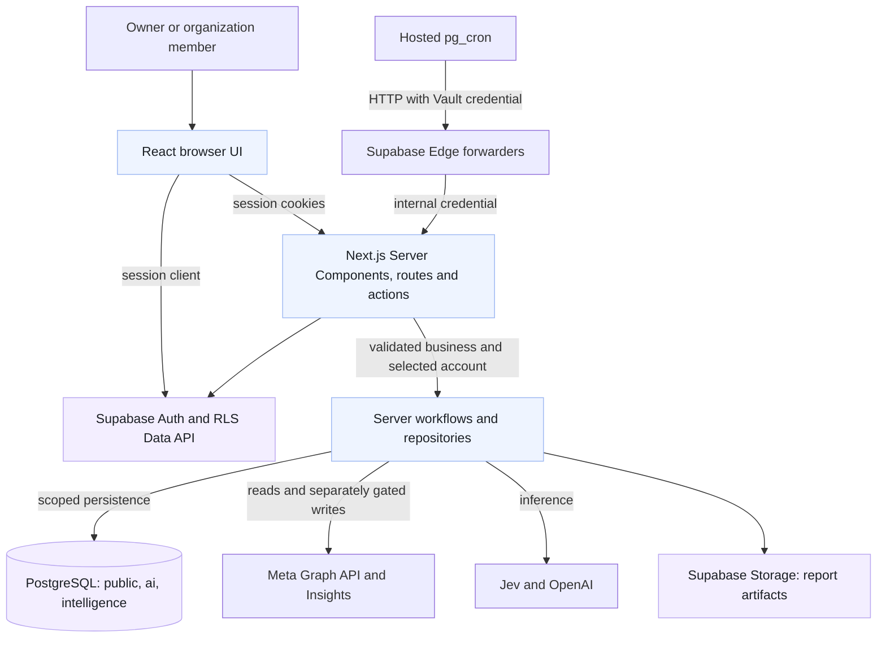

# System relationships

Purpose: locate runtime boundaries before following a workflow or changing a contract.
The [editable draw.io overview](system-overview.drawio) contains **System context**
and **Runtime containers** pages. The runtime page follows the Mermaid below; the
context page is a curated native-shape overview. Edit those sources together.
[Database relationships](DATABASE_RELATIONSHIPS.md) distinguish enforced references;
[Flows](FLOWS.md) traces synchronization and intelligence.

Arrows are calls/data dependencies, not foreign keys or proof of deployment.
Next.js owns the worker implementation; Edge functions forward to authenticated
Next.js routes. There is no separate continuously running worker container in this
source. Browser refresh reloads saved data; the sync API initiates Meta reads.

| Boundary / source of truth | Implementation and consistency concern |
| --- | --- |
| Identity: Supabase Auth; tenant role: PostgreSQL membership | [Context](../src/lib/server/actions/app/context.ts), [selection](../src/lib/server/actions/app/selection.ts), [proxy](../src/proxy.ts). Proxy excludes APIs; handlers authorize independently. |
| Delivery and attribution: Meta; app observations: PostgreSQL | [Fetch](../src/lib/server/sync/meta/fetch.ts), [worker](../src/lib/server/sync/meta/processBackfillJobs.ts). Saved observations can lag current delivery and revised attribution. |
| Application authorization versus RLS | [Session client](../src/lib/server/supabase/server.ts), [admin client](../src/lib/server/supabase/admin.ts). Service-role access bypasses RLS; callers/RPCs must preserve tenant scope. |
| Durable queue versus response lifecycle | [Dispatch](../src/lib/server/sync/dispatch.ts), [Edge forwarder](../supabase/functions/_shared/processAccountSyncJobs.ts). `after()` work can be interrupted; claims/recovery live in PostgreSQL. |
| Inference versus authority to act | [DecisionEngine](../src/lib/server/decisions/DecisionEngine.ts), [review](../src/lib/server/decisions/review/service.ts), [executor](../src/lib/server/advertising/ReviewExecutor.ts). Provider output and approval cannot directly write to Meta. |
| Saved report files | [Archive storage](../src/lib/server/reports/pdf/archiveStorage.ts). Storage availability and report queue state are separate. |

## Verification ledger — 2026-11-13

Source baseline: `ef313aff8f23ebbe20211006969a1ff05ae18f9e`, current Codex documentation
worktree. No other worktree or uncommitted Campaigns implementation was inspected.
Read-only MCP inspection targeted the project identified by the existing
[cron runbook](../supabase/cron/README.md): `gkdyyjqepzayjdpvqnja` (development,
PostgreSQL 17, us-east-1). Metadata only; no customer rows, credentials or cron
command payloads were retrieved.

| Observed metadata | What it establishes / does not establish |
| --- | --- |
| `pg_constraint`, column nullability, indexes, selected triggers | Physical ERD edges and uniqueness. Does not certify every function or every permitted write. |
| All 71 base tables across public/ai/intelligence have RLS enabled | Selected entity/job/feature policies use business membership. Does not prove all grants, function privileges, views or tenant cases are safe. |
| Legacy dimension/performance views have `security_invoker=true` | Compatibility names are views over normalized storage, not duplicate physical tables. |
| `process_account_sync_jobs` v5, alias `process_meta_backfill_jobs` v16, `queue_account_sync_jobs` v4, `process_calendar_queue` v16: ACTIVE, JWT verification false | Functions exist. Custom cron authentication is visible in local handlers; remote code parity, secrets and successful forwarding were not verified. |
| Worker job 66 active, `*/10 * * * *`; calendar job 61 active, `* * * * *` | Actual cadence differs from job names. No run health or completed sync was verified. |
| Enqueue job 13 inactive, `0 */1 * * *`; jobs 54–58 inactive | Recurring enqueue is not active. Proposed two-hour cadence is only an operator procedure. |
| Maintenance jobs 69 hourly and 70 daily active | Operational maintenance is configured; no changes made. |

Deployment host/project, hosted Next.js revision, external Meta subscriptions,
provider credentials, resource/Insights feature flags and live execution gates remain
**unverified**. Local resource and Insights implementations are gated; schema existence
is not enablement. CI checks/builds the app in [ci.yml](../.github/workflows/ci.yml);
that workflow does not deploy it. Stripe and other installed libraries do not establish
an enabled integration. No webhook receiver/subscription was found in `src` or
`supabase`; see the explicit absence boundary in [Flows](FLOWS.md).

Architecture risks are recorded separately in the [audit](ARCHITECTURE_AUDIT.md#phase-2-relationship-review--2026-11-13).

## Documentation validation — Phase 2

- All 14 Mermaid blocks in Architecture, Flows, Database relationships and this page
  converted successfully with draw.io Desktop; exported PNGs were visually inspected.
  Crowded ERDs were split/simplified, with omitted FKs documented beside each view.
- Both native draw.io pages parse as XML; context and runtime exports were inspected
  for clipped labels and connector routing. Native shapes remain editable.
- 147 local file/heading links checked; `git diff --check` passed. Rendered previews
  remain local under `/tmp/dv-phase2-render`, not a second maintained diagram set.
- Application tests, typecheck, lint and build were not run: no application, schema,
  dependency or runtime configuration changed. No application UI screenshots or live
  integration tests were performed. No deployment or migration is required.
